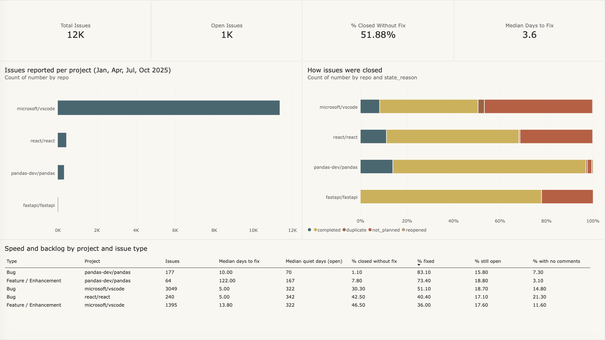
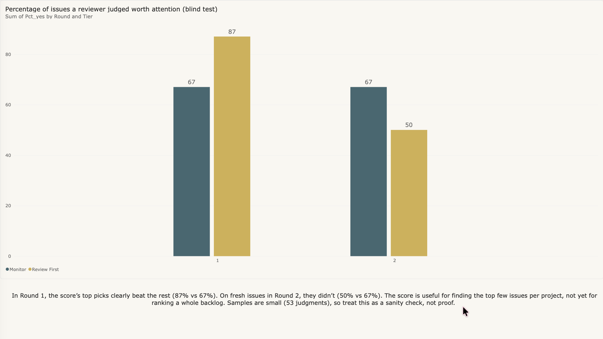
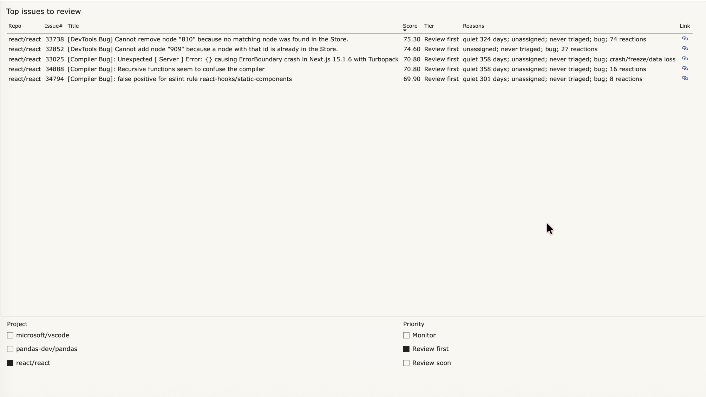

# GhostCommit

**Finding the bug reports that big software projects forget, and figuring out which ones actually deserve attention.**

Python · SQL (DuckDB) · Power BI · GitHub API



## Why I built this

I kept thinking about how many problems people report that never get fixed. Open-source projects like VS Code and React are a good place to look at that, because every bug report is public. Thousands of people report issues. Some get fixed in days, and others sit for a year with nobody looking at them, including real crashes that dozens of people hit.

The teams aren't lazy. They just get far more reports than they can read. VS Code got over 4,700 new issues in July 2025 alone. And sorting by "oldest first" doesn't help, because the oldest issues are often the least important. So I wanted to see if data could point a team to the forgotten issues worth looking at first.

## How it helps

GhostCommit is meant to give a busy team a short, explained list: *of everything that's been forgotten, look at these few first, and here's why.* Every issue on the list shows the reasons it ranked high, so a team can check the logic instead of trusting a number.

In my testing, this worked well for picking the top few issues in projects with good labels (React and pandas), but not yet for ranking a whole backlog. The same idea could apply anywhere there's a backlog bigger than the team: support tickets, IT requests, customer complaints.

## What I looked at

12,114 GitHub issues from VS Code, React, pandas and FastAPI, all created in January, April, July and October 2025 (snapshot taken October 2026). FastAPI only had 9, so I mostly left it out.

## What I found

- **"Closed" doesn't mean "fixed."** About half of closed issues were closed as "not planned" or "duplicate." React actually closes more bugs without fixing them (43%) than it fixes (40%), while pandas fixes 83%.
- **React's forgotten issues are mostly about its newer tools.** The top ones are Compiler and DevTools bugs: unassigned, unconfirmed and quiet for about a year. One has 74 reactions.
- **Scoring works best when teams label well.** My score did well on React and pandas but struggled on VS Code, where almost everything gets the same generic "bug" label.

## How it works

1. **Collect** every issue with the GitHub API. My first version only grabbed 100 per month, which gave me 400 VS Code issues out of about 11,000 (plus a weird coincidence where three projects showed exactly 45 open issues). So I rebuilt it to grab everything.
2. **Clean and categorize** with SQL. Each project labels things differently, so the rules check labels first, then title patterns like React's `Bug:` and pandas' `BUG:`.
3. **Score** each open issue from 0 to 100: how neglected it is (quiet time, unassigned, never triaged) plus how important it looks (bug, crash, regression, reactions), minus points for duplicates, cosmetic stuff, or issues waiting on the person who reported them. Every score comes with a plain reason, like *"quiet 324 days; unassigned; bug; 74 reactions."*

**Example:** React issue [#33738](https://github.com/react/react/issues/33738), a DevTools bug, ranks near the top of React's list. Here's why:

- **74 reactions:** lots of developers hit this bug, so fixing it would help many people at once.
- **Unassigned and still unconfirmed:** nobody owns it, so without a nudge it will likely stay forgotten.
- **Quiet for 324 days:** nothing has happened on it in almost a year.
- **It's a bug, not a feature request:** something is broken for people right now.

An old cosmetic request with no reactions would score much lower, even if it's older, because fewer people are affected and nothing is actually broken.

## Did the score actually work?

I tested it blind: I read issues without seeing their scores and marked which ones deserved attention.



- **Round 1:** the score's top picks won, 87% vs 67%. For React and pandas, the top 5 picks were 10 for 10.
- **Round 2** (after I tweaked the score, on issues I hadn't seen): they didn't, 50% vs 67%.

So it's good at picking a short list of top issues, but not at ranking a whole backlog yet. It's also only 53 judgments by one person (me), so it's a sanity check, not proof.

## Dashboard

Built in Power BI with DAX measures. You can filter by project and priority to get a shortlist, with links straight to each issue.



## Run it yourself

```
pip install -r requirements.txt
export GITHUB_TOKEN=your_token
python3 src/collect_v2.py
python3 src/run_sql.py sql/attention_score_v2.sql
```

The Power BI dashboard is GhostCommit.pbix
